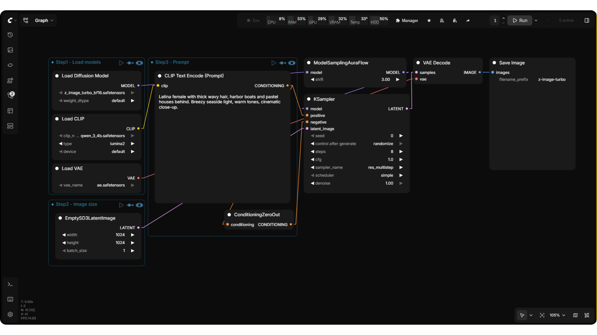
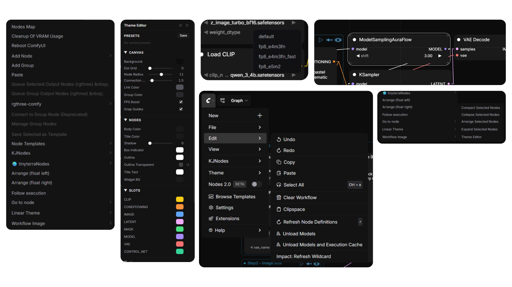
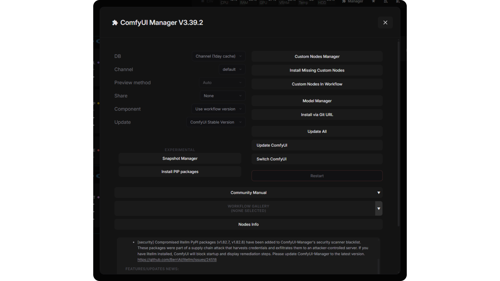
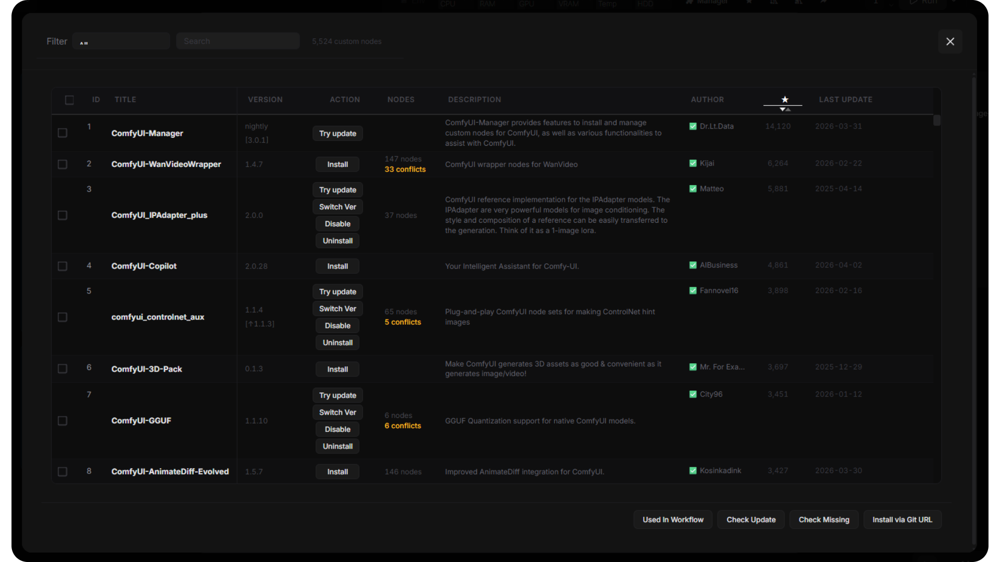

# ComfyUI Linear Theme

A premium dark theme for ComfyUI. Pure black aesthetic, FPS-optimized, fully customizable.

Mainly inspired by the Freepik Spaces canvas, with touches of Linear, Vercel, and Raycast.



## Features

### Visual
- **Complete UI overhaul** — nodes, widgets, sidebars, dialogs, menus, buttons, inputs, scrollbars, tooltips
- **Pure black palette** — zinc scale, no glassmorphism, no gradients, no added transitions
- **Chevron arrows** on connection inputs — clean directional markers, color-matched per slot type
- **Minimal groups** — thin border + dot + title, no blur, no shadows
- **Collapsed nodes** — full title always visible, color-coded dots based on connected inputs
- **Execution glow** — running nodes highlight purple, completed flash green, errors flash red
- **Styled Manager** — ComfyUI Manager dialog fully themed

### Performance
- **FPS Boost** — idle throttle, low-zoom render skip, no shadowBlur
- **Snap Guides** — alignment lines when dragging nodes (toggleable)
- **Lightweight** — single JS file, no dependencies, no build step

### Customization
- **Theme Editor** — right-click → Linear Theme to tweak everything live
  - **Canvas** — background, node radius, connection width, link color, group color
  - **Nodes** — body, title, shadow, outline, widget colors
  - **Slots** — per-type connection colors (CLIP, MODEL, IMAGE, etc.)
  - **UI** — surfaces, borders, text, bars, accents
- Per-field reset, inline save/load presets, persists across sessions
- Keyboard-accessible editor with visible focus and viewport-safe positioning
- Ordered config saves with a retry action when saving fails



## Screenshots

### ComfyUI Manager — fully themed


### Custom Nodes Manager


## Install

### Option 1: ComfyUI Manager (recommended)
Search for **Linear Theme** in the Manager and install.

### Option 2: Clone
```bash
cd ComfyUI/custom_nodes
git clone https://github.com/Arroz-11/ComfyUI-Linear-Theme.git
```

Restart ComfyUI after installing.

### Canvas color palette
The **Linear Dark** palette (slot colors, link colors, node body, etc.) registers and activates automatically on first launch. If you switch to another palette later, it is not automatically re-selected; the theme's own configured colors still apply. Re-select **Linear Dark** in **Settings → Appearance → Color Theme** anytime, or import `linear_dark.json` manually.

## Compatibility

Tested with **ComfyUI 0.40.0 / frontend 1.55.17**, using both the classic canvas and **Nodes 2.0**. Collapsing nodes preserves inputs, outputs and connections; explicit node colors and shapes are retained. Custom node interfaces may require additional styling.

After updating, reload ComfyUI with **Ctrl+F5** to load the updated frontend extension.

## License

MIT
